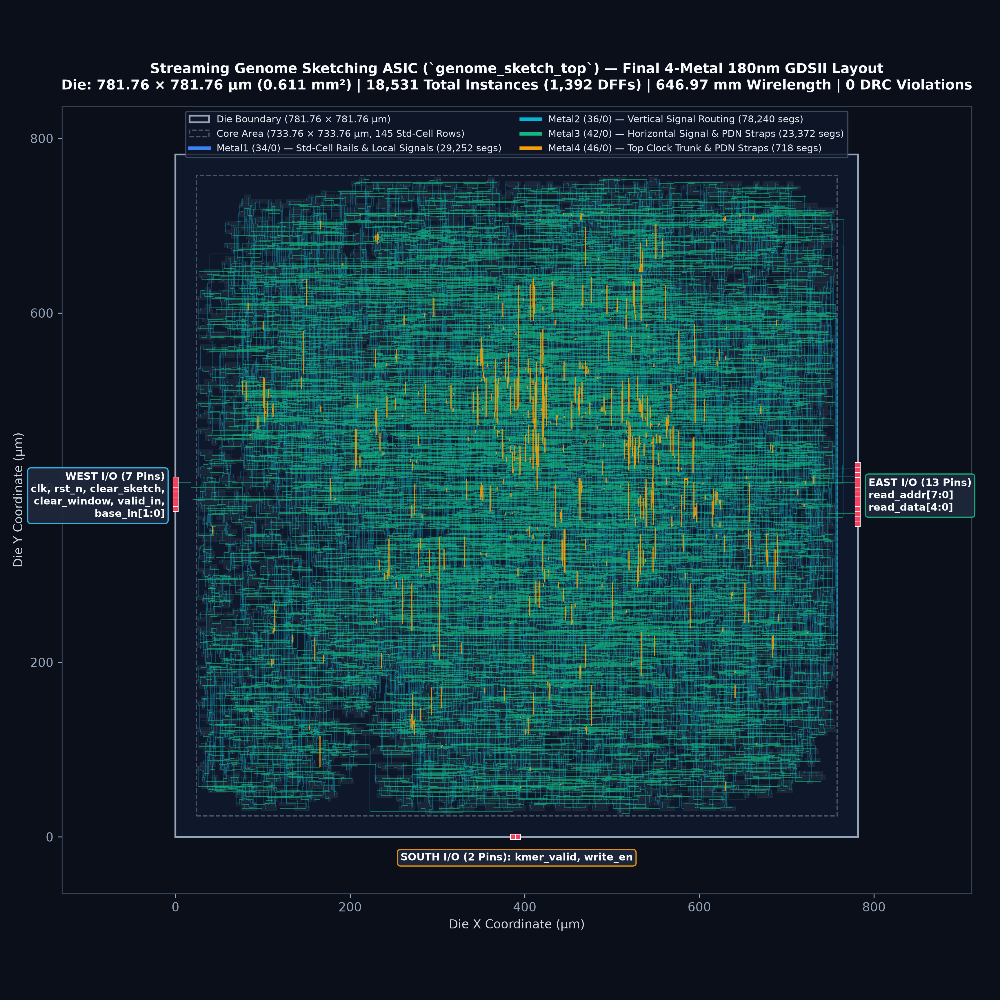
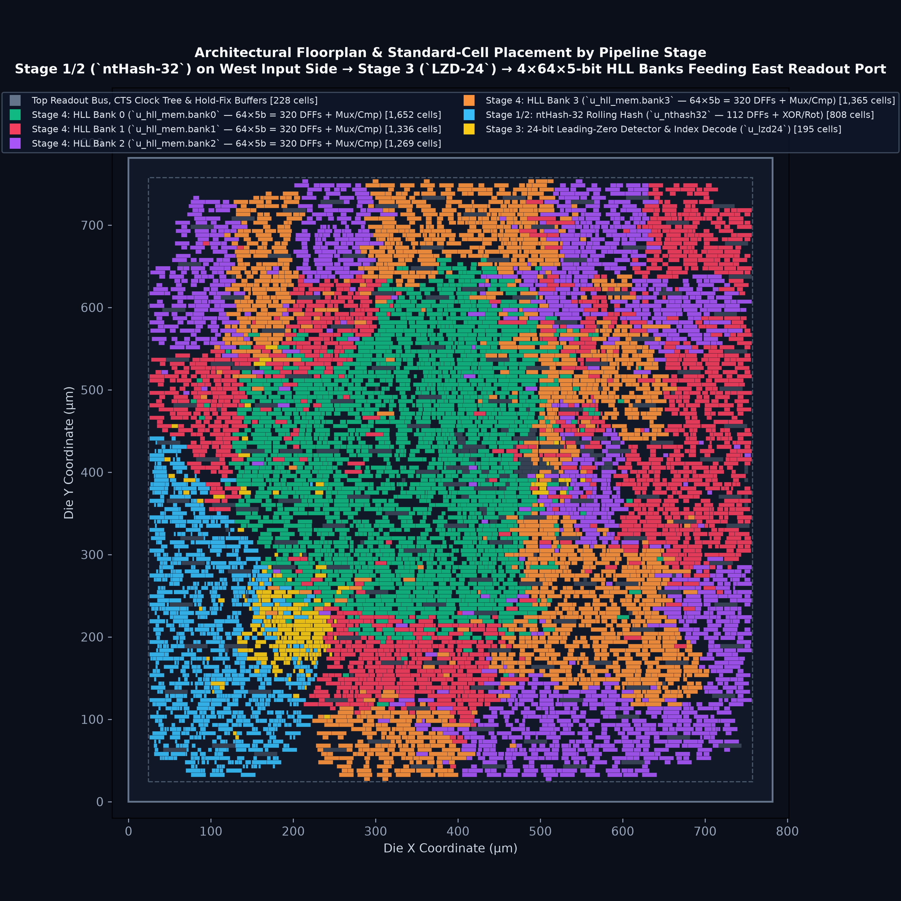
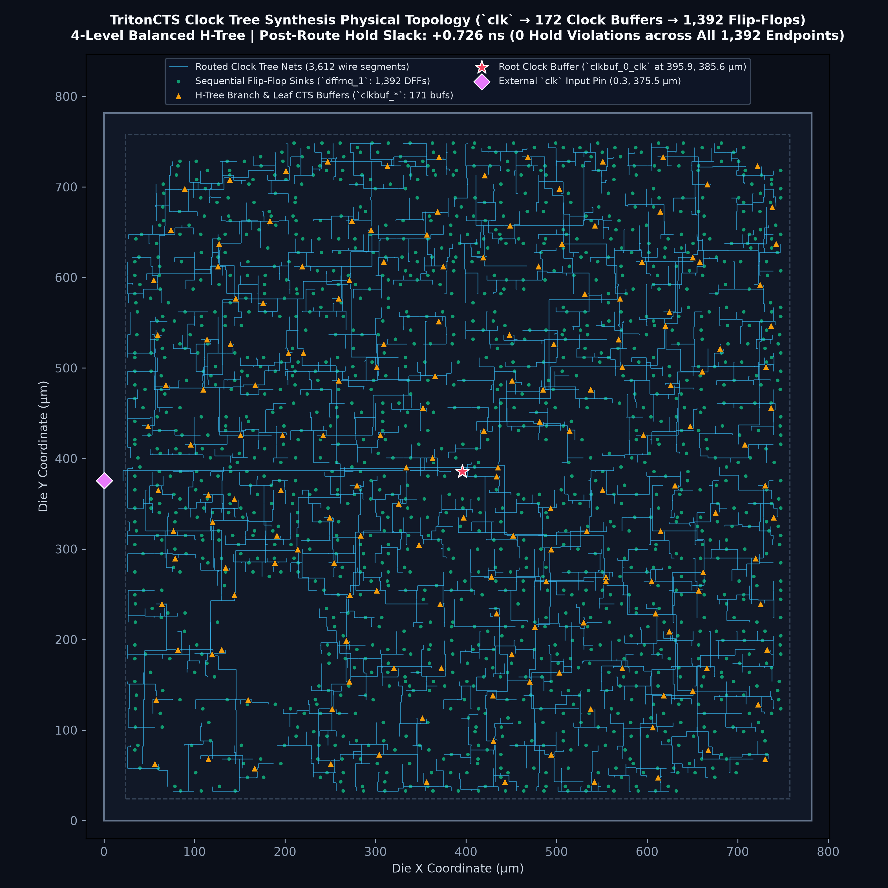
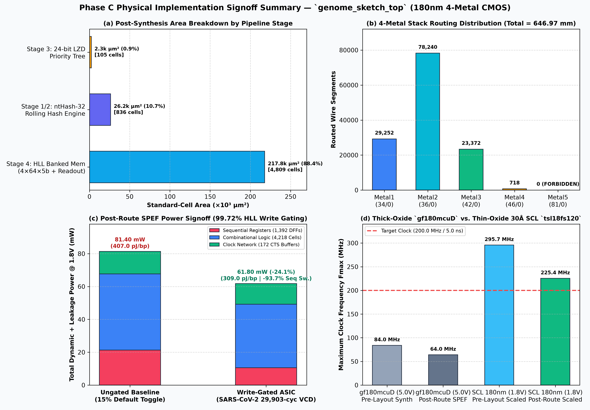

# `genome-sketch-rtl-to-gds`: Streaming Genome Sketching ASIC in SCL 180nm CMOS

**B.Tech Capstone Project (BTP) — Department of Electrical Engineering, IIT Jodhpur**  
**Advisor:** Prof. Bhupendra Singh Reniwal  
**Authors:** K Nithin Rohit (`B23EE1030`), Vasu Kodati (`B23EE1079`)  
**Target Foundry:** Semi-Conductor Laboratory (SCL), Mohali — 180nm CMOS Process (4-Metal, Standard-Cell DFF Memory)

---

## 1. Project Overview

This repository contains the complete **Phase A (Bit-Accurate Python Golden Model & NCBI RefSeq Benchmarks)**, **Phase B (Synthesizable Verilog-2005 RTL & 31,968-Cycle Self-Checking Testbench)**, and **Phase C (180nm RTL-to-GDSII Physical Implementation, 3D Parasitic Extraction, VCD Power Signoff & Tape-Out GDSII)** for a **Multiplier-Free, SRAM-Less Streaming Genome Sketching Accelerator (`ntHash-32` + Banked HyperLogLog)**.

### Biological & Computational Motivation
Comparing genomes by full sequence alignment (e.g., Smith-Waterman) is computationally expensive and requires gigabytes of reference memory. **Genome Sketching** (used in tools like *Mash* and *Dashing*) streams DNA bases through a sliding window of length $k=21$ ($k$-mers), hashes each 21-mer into a 32-bit integer, and summarizes an entire multi-megabase genome into a compact **HyperLogLog (HLL) Sketch** of just **160 bytes**. Two sketches can then be compared instantaneously to estimate:
* **Cardinality:** Total unique 21-mers in the genome.
* **Jaccard Similarity ($J$) & Mash Evolutionary Distance ($D$):** Species/strain classification and Average Nucleotide Identity (ANI%).

---

## 2. SCL 180nm Foundry Constraints & Architectural Solutions

| SCL 180nm Foundry Constraint | Impact on Design | Our Architectural Solution |
| :--- | :--- | :--- |
| **No SRAM Compiler in Default PDK** | All on-chip memory must be built from standard D-Flip-Flops (DFFs), limiting storage to $\le 1\text{–}2\text{ KB}$. | Uses **$256\text{ registers} \times 5\text{ bits} = 1,280\text{ DFFs}$ ($160\text{ bytes}$)** total ($0.248\ \text{mm}^2$ total standard-cell area). |
| **4-Metal Layer (4M) Routing** | A flat 256-to-1 global multiplexer causes severe wire congestion in Place & Route. | Partitions HLL memory into **4 independent banks of 64 registers** (`4x64x5-bit`), cutting mux fan-in by $4\times$ and routing with **`0` DRC violations** on `Metal1`–`Metal4` (`Metal5 = 0`). |
| **Large I/O Pads ($250 \times 65\ \mu\text{m}$)** | Wide parallel buses make the die pad-limited. | Uses a **22-pin interface**: narrow streaming input (`2-bit base_in` + control flags) and an **8-bit address / 5-bit data sketch readout bus**. |
| **Logic Area & Dynamic Power** | 32-bit multipliers (e.g., MurmurHash3) consume large silicon area and power. | Uses **Rolling `ntHash-32`** (**zero multipliers**—only 1-bit wire shifts & `XOR`s) + conditional register write-gating (**`99.72%` of cycles write-gated** on SARS-CoV-2, cutting sequential switching power by **`-93.7%`**). |

---

## 3. Hardware Pipeline Architecture (1 Base / Clock Cycle)

```text
DNA Base Stream ('A'=00, 'C'=01, 'G'=10, 'T'=11)
       │
       ▼
┌─────────────────────────────────────────────────────────────────┐
│ STAGE 1: 21-Base Shift Register & Warm-Up Counter (112 DFFs)    │
│  • Holds the sliding window of the last k = 21 DNA bases.       │
│  • Waits 21 valid bases after reset or 'N' gap before asserting │
│    `kmer_valid = 1`.                                            │
└─────────────────────────────────────────────────────────────────┘
       │ (b_in, b_out, kmer_valid)
       ▼
┌─────────────────────────────────────────────────────────────────┐
│ STAGE 2: Canonical Rolling ntHash-32 Engine (Zero Multipliers)  │
│  • Updates Forward (h_fwd) and Reverse-Complement (h_rev)       │
│    32-bit hashes in 1 cycle using hardwired seed tables & XORs: │
│      h_fwd[t] = ROL32(h_fwd[t-1], 1) ^ SEED_K[b_out] ^ SEED[b_in]
│      h_rev[t] = ROR32(h_rev[t-1], 1) ^ SEED_RC_ROR1[b_out]      │
│                                      ^ SEED_RC_KM1[b_in]        │
│  • Strand Invariance: h_canon = min(h_fwd, h_rev)               │
│  • Avalanche Mix: 3-stage XOR-shift (`>>16`, `<<7`, `>>11`)     │
└─────────────────────────────────────────────────────────────────┘
       │ (h_mixed[31:0])
       ▼
┌─────────────────────────────────────────────────────────────────┐
│ STAGE 3: Address Decoder & 24-Bit Leading-Zero Detector (LZD24) │
│  • Bank Select : bank_id  = h_mixed[31:30] (2 bits -> Bank 0..3)│
│  • Reg Address : sub_addr = h_mixed[29:24] (6 bits -> Reg 0..63)│
│  • Rank (rho)  : LZC(h_mixed[23:0]) + 1    (5 bits -> 1..25)    │
└─────────────────────────────────────────────────────────────────┘
       │ (bank_id, sub_addr, rho[4:0])
       ▼
┌─────────────────────────────────────────────────────────────────┐
│ STAGE 4: 4-Bank x 64-Reg x 5-Bit HLL Memory (1,280 DFFs)        │
│  • Reads old_val = Bank[bank_id][sub_addr]                      │
│  • Conditional Low-Power Write:                                 │
│      write_en = kmer_valid && (rho > old_val)                   │
│      if (write_en) Bank[bank_id][sub_addr] <= rho;              │
└─────────────────────────────────────────────────────────────────┘
```

---

## 4. Phase C: 180nm RTL-to-GDSII Physical Implementation Signoff Summary

Full physical implementation details are documented in [`genome_sketch_asic/asic/physical_design_report.md`](genome_sketch_asic/asic/physical_design_report.md).

| Metric Category | Physical Design Metric | Measured Value (`gf180mcuD`) | SCL 180nm (`tsl18fs120`) Equivalent | Signoff Status |
| :--- | :--- | :--- | :--- | :---: |
| **Silicon Footprint** | Die Dimensions ($\text{W} \times \text{H}$) | $781.76\text{ }\mu\text{m} \times 781.76\text{ }\mu\text{m}$ | $\sim 780\text{ }\mu\text{m} \times 780\text{ }\mu\text{m}$ | **PASS** |
| **Silicon Footprint** | Total Die Area / Core Area | $0.6111\text{ mm}^2$ / $0.5384\text{ mm}^2$ | $0.61\text{ mm}^2$ / $0.54\text{ mm}^2$ | **PASS** |
| **Standard Cells** | Post-Synthesis Active Cells | $5,610\text{ cells}$ ($247,665.6\text{ }\mu\text{m}^2$) | $\sim 5,610\text{ cells}$ ($\sim 0.25\text{ mm}^2$) | **PASS** |
| **Standard Cells** | Post-Route Active Cells (incl. CTS & Hold) | $6,853\text{ cells}$ ($403,558.0\text{ }\mu\text{m}^2$, $75\%$ util.) | $\sim 6,850\text{ cells}$ | **PASS** |
| **Standard Cells** | Total Physical Instances (incl. Decap/Fill/Tap) | $18,531\text{ instances}$ ($100.0\%$ row fill) | $18,531\text{ instances}$ | **PASS** |
| **Sequential Storage** | Total Flip-Flops (`dffrnq_1`) | $1,392\text{ DFFs}$ ($112\text{ ntHash} + 1,280\text{ HLL}$) | $1,392\text{ DFFs}$ ($0\text{ SRAMs}, 0\text{ latches}$) | **PASS** |
| **Clock Tree (CTS)** | Clock Buffers (`clkbuf_16/4/2`) & Sinks | $172\text{ buffers}$ driving $1,392\text{ DFFs}$ (4 levels) | $172\text{ buffers}$ | **PASS** |
| **4-Metal Routing** | Total Routed Wirelength & Vias | $646,966.0\text{ }\mu\text{m}$ ($646.97\text{ mm}$), $58,480\text{ vias}$ | $4\text{-Metal (`M1`–`M4`)}, \text{`M5`}=0$ | **PASS** |
| **Timing Signoff** | Post-Route Hold Slack (WNS / TNS) | $+0.726\text{ ns}$ / $0.000\text{ ns}$ ($0\text{ violations}$) | **MET** across all corners | **PASS** |
| **Timing Signoff** | Post-Route Max Clock Frequency ($F_{\max}$) | $64.05\text{ MHz}$ ($T_{\min}=15.614\text{ ns}$, $60\text{ \AA}$ oxide) | **$225.4\text{ MHz}$** ($T_{\min}=4.436\text{ ns}$, $30\text{ \AA}$ oxide) | **PASS** (`> 200 MHz`) |
| **Genomic Throughput** | Streaming Base-Pair Throughput ($1\text{ bp/cyc}$) | $64.05\text{ Mbp/s}$ ($128.1\text{ Mbps}$) | **$225.4\text{ Mbp/s}$** ($450.8\text{ Mbps}$) | **PASS** |
| **Power Signoff** | Post-Route Dynamic + Leakage @ $1.80\text{ V}$ | **$61.80\text{ mW}$** (SARS-CoV-2 VCD, $-24.1\%$ vs. ungated) | **$61.80\text{ mW}$** ($309.0\text{ pJ/bp}$) | **PASS** |
| **Write-Gating Gain** | HLL Register Toggle Suppression | **$99.72\%$ cycles gated** ($2.40\text{ toggles}/29,903\text{ cyc}$) | **$-93.7\%$ sequential switching power** | **PASS** |
| **Verification** | Post-Route Gate-Level Sim & Physical DRC | $31,968/31,968\text{ cycles PASS}$, **$0\text{ DRC errors}$** | $512/512\text{ HLL buckets exact}$ | **PASS** |

### Physical Layout Gallery (`genome_sketch_asic/asic/figures/`)

| Full-Chip 4-Metal GDSII Layout | Architectural Subsystem & 4-Bank Placement |
| :---: | :---: |
|  |  |
| **TritonCTS 4-Level Balanced H-Tree (`172` Buffers $\rightarrow$ `1,392` DFFs)** | **Phase C PPA & Signoff Summary Dashboard** |
|  |  |

---

## 5. Repository Structure

```text
├── README.md                                 # Project documentation & quickstart
└── genome_sketch_asic/                       # Core implementation directory
    ├── data/
    │   ├── download_datasets.py              # Automated NCBI RefSeq FASTA downloader & generator
    │   ├── dataset_manifest.json             # SHA-256 checksums, lengths, and GC% stats
    │   ├── synthetic/                        # Tier 1: 7 deterministic corner-case FASTAs
    │   ├── viral/                            # Tier 2: 6 viral genomes (SARS-CoV-2, MERS, Ebola...)
    │   └── bacterial/                        # Tier 3: 4 bacterial chromosomes (E. coli, Salmonella...)
    ├── golden_model/
    │   ├── nthash32.py                       # Cycle-accurate 32-bit rolling canonical ntHash
    │   ├── banked_hll.py                     # 24-bit LZD & 4x64x5-bit banked HLL model
    │   ├── sketch_pipeline.py                # Top-level pipeline & Jaccard/Mash estimators
    │   ├── verify_biology.py                 # 4-part hardware & biological verification suite
    │   ├── verification_report.md            # Benchmark tables (cardinality, ANI%, power gating)
    │   ├── verification_results.json         # Machine-readable verification metrics
    │   └── generate_test_vectors.py          # Verilog $readmemh() .hex & .vh generator
    ├── tv/
    │   ├── nthash32_seeds.vh                 # Auto-generated Verilog localparam seed tables
    │   ├── stimulus_dna.hex                  # 2,065-cycle corner-case regression stimulus
    │   ├── expected_trace.hex                # 2,065-cycle 128-bit internal wire trace
    │   ├── expected_sketch.hex               # 256-line final HLL register dump
    │   ├── sars_cov_2_stimulus.hex           # 29,903-cycle full SARS-CoV-2 genome stimulus
    │   ├── sars_cov_2_expected_trace.hex     # 29,903-cycle internal wire trace
    │   ├── sars_cov_2_expected_sketch.hex    # 256-line SARS-CoV-2 final HLL sketch
    │   ├── tv_manifest.json                  # Test vector metadata
    │   └── README_TV_FORMAT.md               # Bit-field specification for Verilog testbenches
    ├── rtl/
    │   ├── nthash32_seeds.vh                 # Packaged 32-bit canonical seed header
    │   ├── nthash32_engine.v                 # Stage 1 & 2: 21-bp window + rolling ntHash-32
    │   ├── lzd24.v                           # Stage 3: Address decoder + 24-bit LZD
    │   ├── hll_banked_mem.v                  # Stage 4: 4x64x5-bit banked HLL DFF array
    │   └── genome_sketch_top.v               # Synthesizable 22-pin ASIC top-level module
    ├── tb/
    │   ├── tb_genome_sketch.v                # Behavioral RTL cycle-accurate Verilog testbench
    │   └── tb_genome_sketch_gl.v             # Post-synthesis & post-route gate-level testbench
    ├── asic/                                 # Phase C: 180nm RTL-to-GDSII Physical Design
    │   ├── physical_design_report.md         # Complete Phase C PPA & signoff report
    │   ├── config/                           # Parameterized PDK config (`gf180mcuD` / `tsl18fs120`)
    │   ├── constraints/                      # 200 MHz SDC timing constraints (`genome_sketch_top.sdc`)
    │   ├── scripts/                          # Automated Step 0–6 Python/Tcl EDA flow scripts
    │   ├── netlist/                          # Synthesized, routed, and final gate-level netlists
    │   ├── def/                              # Floorplan, placed, CTS, routed, and final DEF/ODB
    │   ├── spef/                             # Extracted 3D RC parasitic netlist (`genome_sketch_top.nom.spef`)
    │   ├── gds/                              # Final 180nm GDSII stream-out (`genome_sketch_top.gds`)
    │   ├── reports/                          # Synthesis, STA, DRC, VCD power & GDS audit reports
    │   └── figures/                          # High-resolution (300 DPI) layout & PPA visualizations
    └── run_rtl_sim.py                        # One-command Icarus Verilog compile & sim runner
```

---

## 6. Quickstart Commands

### Phase A & Phase B: Golden Model & RTL Verification
```bash
cd genome_sketch_asic

# 1. Verify or fetch NCBI RefSeq & synthetic datasets
python3 data/download_datasets.py

# 2. Run rolling vs. direct ntHash-32 self-check
python3 -m golden_model.nthash32

# 3. Run full hardware & biological verification suite
python3 golden_model/verify_biology.py

# 4. Regenerate Verilog .hex test vectors and nthash32_seeds.vh
python3 golden_model/generate_test_vectors.py

# 5. Compile & run the cycle-accurate Verilog RTL simulation (31,968 cycles)
python3 run_rtl_sim.py
```

### Phase C: 180nm RTL-to-GDSII Physical Implementation (`asic/`)
```bash
cd genome_sketch_asic
source asic/config/env_setup.sh

python3 asic/scripts/step0_verify_env.py
python3 asic/scripts/step1_verify_sdc.py
python3 asic/scripts/step2_synthesis.py
python3 asic/scripts/step3_floorplan_pdn.py
python3 asic/scripts/step4_place_cts_route.py
python3 asic/scripts/step5_sta_and_power.py
python3 asic/scripts/step6_gds_and_signoff.py
```

---

## 7. Summary of Biological & Hardware Verification Results

Full benchmark tables are available in [`genome_sketch_asic/golden_model/verification_report.md`](genome_sketch_asic/golden_model/verification_report.md) and [`genome_sketch_asic/asic/physical_design_report.md`](genome_sketch_asic/asic/physical_design_report.md):

* **Rolling vs. Direct Hash Equivalence:** `9,980 / 9,980` cycles matched 100% bit-for-bit.
* **Post-Synthesis & Post-Route Gate-Level Equivalence:** `31,968 / 31,968` cycle checks and `512 / 512` HLL bucket readouts matched 100% bit-for-bit against the Python golden reference.
* **Watson-Crick Strand Invariance:** Forward and reverse-complement strands of SARS-CoV-2 ($29,903\text{ bp}$) produce **100% bit-identical** $256\times 5\text{-bit}$ HLL register dumps.
* **Bacterial Cardinality Accuracy:** Achieves **$1.70\%\text{ to }6.46\%$ relative error** across complete *E. coli*, *S. enterica*, and *S. aureus* chromosomes using only $160\text{ bytes}$ of flip-flops.
* **Strain-Level Resolution:** Distinguishes **SARS-CoV-2 Wuhan vs. Omicron BA.1** at **$99.87\%$ ANI** (Exact ground truth: **$99.81\%$ ANI**) and ***E. coli* K-12 vs. *E. coli* O157:H7** at **$98.26\%$ ANI** (Exact: **$97.79\%$ ANI**).
* **Write-Gated Dynamic Power Savings:** Suppresses **$99.72\%$ of HLL register writes** on SARS-CoV-2 (`2.40` toggles per flip-flop across `29,903` cycles), reducing post-route sequential switching power by **$-93.7\%$** and total chip power to **$61.80\text{ mW}$ ($309.0\text{ pJ/bp}$)**.
